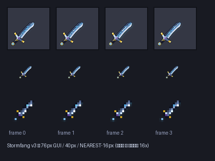
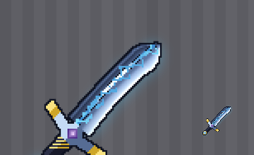

# ⚡ Stormfang — Грозовой Клинок

**Легендарный меч молний для Minecraft 1.21.4 (Fabric).**
Мод полностью собран CI (GitHub Actions), протестирован на реальном выделенном сервере с подключением по игровому протоколу.


## Возможности
- 🗡 **Легендарные характеристики**: база незерита, +5 к урону (9❤ за удар), скорость атаки выше незеритового меча, незерито-прочность, не горит в лаве, редкость EPIC
- 🎨 **Анимированная процедурная текстура 512×512** — нарисована кодом (Python/PIL, SDF-рендер), 4 кадра: импульс энергии бежит по долу клинка, кромка и кристаллы пульсируют
- ✨ **Постоянное свечение зачарования** (`enchantment_glint_override`) — клинок «живой»
- ⚡ **Грозовой разряд (ПКМ)**: рейкаст 40 блоков → настоящая молния в точку прицела + всплески частиц (ELECTRIC_SPARK / END_ROD / LARGE_SMOKE / собственные STORM_SPARK) + синтезированный звук грома; кулдаун 2.5с
- 🌩 **Пассивный шторм-прок**: каждый удар разрядом искр, 35% шанс призвать молнию на цель и подбросить её (mixin в `LivingEntity#hurt`)
- 🧪 **Собственная частица** `stormfang:storm_spark` (процедурная текстура-звезда 32px, поведение End Rod)
-  Творческая вкладка + **рецепт**: незеритовый меч в центре, светокамень сверху/снизу, осколки аметиста по бокам

## Рецепты / команда
```
G G          G = светокамень
A S A        A = осколок аметиста
G G          S = незеритовый меч
```
или `/give @s stormfang:stormfang`

## Сборка
```bash
./gradlew build          # jar → build/libs/stormfang-1.0.0.jar
./gradlew runServer      # headless-сервер с модом (нужен eula в run/)
```
Инструменты: Fabric Loom 1.9.2 · Loader 0.16.9 · Fabric API 0.119.4+1.21.4 · official Mojang mappings · Java 21 · Gradle 8.11.1

## Тестирование в CI
`.github/workflows/build.yml`:
1. `./gradlew build` — компиляция (main + client + mixin refmap)
2. старт **настоящего** Fabric-сервера 1.21.4 (`./gradlew runServer`, headless), проверка строки инициализации мода
3. **mineflayer-бот** подключается по реальному игровому протоколу, получает `/give stormfang:stormfang`, экипирует и **использует способность** — CI сверяет `Thunderclap by 'StormBot'` в логе сервера
4. jar + логи → артефакт, GitHub Release и ветка `dist`

## Скачивание
Смотрите **[Releases](../../releases)** — `stormfang-1.0.0.jar`.
Нужен [Fabric API](https://modrinth.com/mod/fabric-api) для 1.21.4.

## Скриншоты / галерея
| Превью текстуры | Рендер в GUI |
|---|---|
|  |  |

*Игровые скриншоты (лог CI, кадры теста) — см. ниже; добавляются после прогона Actions.*

## Лицензия
MIT © 2026 maksummatov10
